# Android 앱과 홈 화면 위젯

> 기능 계약: [android-monitor](https://github.com/lahuman/Codex_Monitor/blob/main/openspec/specs/android-monitor/spec.md)

Android 8.0 이상 ARM64 휴대폰을 위한 0.1.21 미리보기입니다. 기존 Rust 계정 서비스와 한도·초기화권·로컬 이력 해석을 재사용합니다. PC가 켜져 있을 필요가 없으며 PC 계정이나 이력을 동기화하지 않습니다.

## 설치와 계정 연결

검증한 APK와 `SHA256SUMS.txt`, `release.json`, 설치 안내는 `desktop/releases/0.1.21/android-arm64/`에 생성합니다. APK를 휴대폰으로 복사하고 열어 해당 파일 앱의 알 수 없는 앱 설치 권한을 확인합니다. 미리보기는 Android 디버그 키로 서명하며 Play Store 정식 배포가 아닙니다. 향후 정식 키로 전환할 때 재설치가 필요할 수 있고 삭제하면 계정과 기록도 삭제됩니다. 서명 키 없이 기존 APK의 업데이트 호환성을 약속하지 않습니다.

앱의 계정 탭에서 계정을 연결합니다. 표시된 로그인 주소와 코드를 사용해 Chrome 등 원하는 외부 브라우저에서 인증한 후 앱으로 돌아옵니다. 브라우저에 **Codex에 로그인됨**이 표시되면 **Codex Monitor 앱으로 직접 돌아옵니다**. 앱이 연결을 확인하며, 지연되면 로그인 창의 **연결 상태 다시 확인**을 누릅니다. 사용량 자동 조회 간격과 인증 확인은 별개입니다.

0.1.14부터 진행 중인 인증은 기존 암호화 저장소에 보관하고 재실행 후 복원합니다. 통신 오류는 기존 코드를 유지하며 재확인합니다. 이전 버전에서 이미 잃어버린 인증 대기는 복구할 수 없으므로 업데이트 후 새 연결을 시작하세요. 코드가 만료되거나 제공자가 교환 코드를 거부하면 취소 후 새 코드를 발급받습니다.

인증 정보는 앱 전용 저장소에 보관하며 위젯에는 토큰을 보내지 않습니다. Android 백업과 평문 HTTP는 비활성화합니다.

## 조회 간격과 수동 수집

- **자동 조회 안 함**, **1·5·10·30·60·100분** 중 선택합니다. 기본값은 10분입니다.
- 선택값은 재실행 후에도 유지됩니다. 자동 조회 안 함에서는 앱 시작 시에도 자동으로 사용량을 조회하지 않습니다.
- **지금 수집하기**는 자동 조회가 꺼져 있어도 활성 계정의 사용량과 초기화권을 수집합니다.
- 실패한 자동 조회도 선택한 최소 간격을 지킵니다. 화면의 15초 상태 확인은 제공자 API 호출이 아닙니다. 화면이 숨겨지면 UI와 앱의 조회 타이머는 멈춥니다.
- 백그라운드는 Android WorkManager로 예약합니다. 1·5·10분 선택 시 **최소 15분**, 30·60·100분은 선택 간격을 적용합니다. 네트워크 연결과 배터리 여유가 있어야 실행하며 Doze와 제조사 정책으로 지연될 수 있습니다.
- 자동 조회 안 함 또는 활성 계정이 없으면 예약을 취소합니다. 프로세스가 회수되거나 재부팅되어도 Android가 예약을 관리합니다. **설정에서 강제 종료**하면 사용자가 다시 앱을 열어야 합니다.
- 앱과 작업은 같은 Rust 서비스·수집 잠금을 공유합니다. 요청 시도 시각을 전송 전에 저장해 실패·재시작 후 재요청을 억제합니다. 오류 시 즉시 반복하지 않으며 작업 전체를 120초로 제한합니다.
- 위젯 전용 주기 타이머와 상시 서비스는 사용하지 않습니다. 저장 관측이 바뀔 때 위젯을 갱신하며 마지막 작업 시각·결과를 앱에 표시합니다. 실제 배터리 소모율은 기기에서 별도 측정이 필요합니다.

## 홈 화면 위젯

앱의 **홈 화면 위젯 추가**에서 미리보기를 보며 설정한 뒤 홈 화면에 추가합니다. 홈 화면을 길게 눌러 **Codex Monitor**를 선택해도 됩니다. 위젯 우측의 **설정**으로 언제든 변경할 수 있습니다.

- **표시 계정**: 전체 계정 비교 또는 원하는 계정 하나를 선택합니다. 계정마다 위젯을 따로 추가할 수 있습니다.
- **그래프 모양**: 개별 계정은 원형 게이지와 가로 막대 중 선택합니다. 전체 비교는 위젯 크기에 맞춰 최대 네 계정의 막대를 보여주며 표시 수/전체 수를 안내합니다.
- **테마**: 시스템 설정 따르기·밝게·어둡게를 선택합니다.
- **계정 이름 숨기기**: 별명 대신 계정 번호를 표시합니다. 한 위젯의 설정을 바꿔도 다른 위젯은 유지됩니다.

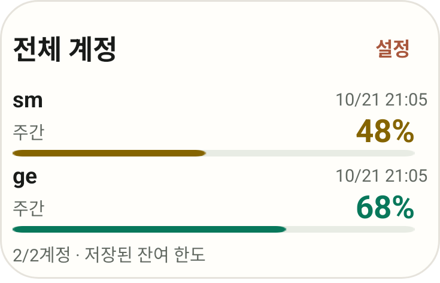

0.1.18부터 기본 크기는 **4×2칸**이며, 카드가 내용 높이에 맞게 줄어듭니다. 계정 목록과 하단 안내 사이에 빈 공간을 늘리지 않습니다. 기존에 배치한 위젯의 홈 화면 점유 칸은 런처가 유지하므로 **위젯을 길게 누르고 아래쪽 손잡이를 위로 올려** 높이를 줄이세요. 런처에 따라 삭제 후 다시 추가해야 새 기본 크기가 적용될 수 있습니다.

0.1.19에서는 **기간 표시 · 두꺼운 막대 · 오른쪽 잔여 %**를 한 줄로 표시합니다. 막대는 12dp 두께이며 기간 옆의 작은 색상 점과 같은 잔여율 색상을 사용합니다. 두 기간이 있는 계정은 기간별로 한 줄씩 표시하므로, 위젯 높이에 따라 보이는 계정 수가 달라질 수 있습니다. 원형 게이지는 기존 선택을 유지합니다.

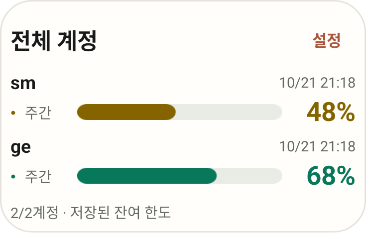

0.1.20에서는 업데이트 시각을 **오른쪽 상단에 한 번** 표시합니다. 표시 중인 계정의 유효한 관측 중 가장 최근 시각이며, 계정의 관측이 2분 넘게 뒤처지면 **이전 관측**으로 구분합니다. 위젯을 다시 그린 시간이 아닙니다. 갱신 영역을 누르면 표시 설정을 열 수 있습니다.

**5시간·주간 각각의 그래프 아래 `↻ MM/dd HH:mm`**는 해당 한도의 초기화 예정 시각입니다. 0.1.21부터 막대 아래 전체 너비를 사용하고 원형 게이지는 필요하면 줄바꿈해 날짜와 시간이 잘리지 않도록 합니다. 시스템 글자 크기와 위젯 너비·높이로 실제 레이아웃을 측정해 표시 계정 수를 조정합니다. 한 계정도 들어가지 않으면 **위젯을 키워 주세요**를 표시하므로 위젯을 길게 누르고 높이를 늘리세요. 제공되지 않은 시각은 `↻ 미확인`으로 표시합니다. 초기화권의 만료일과는 별개입니다.

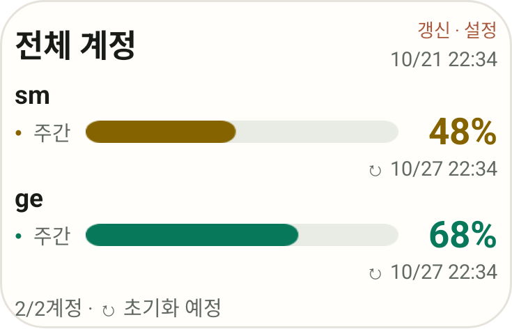

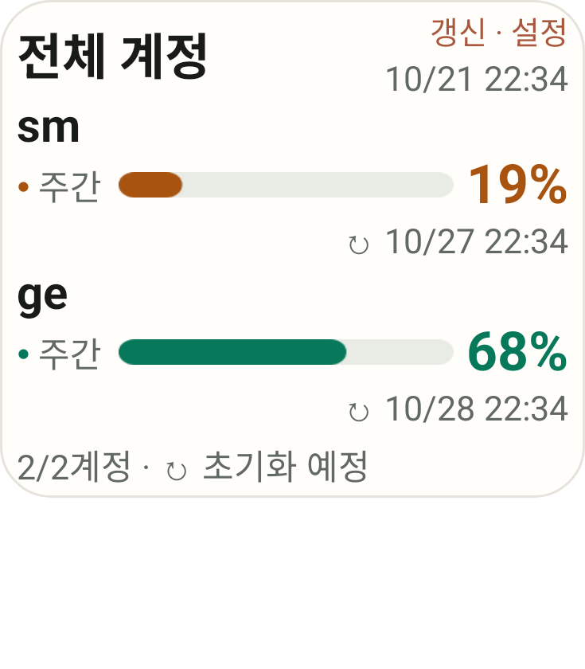

개별 위젯에는 기간별 잔여율, 초기화권 수량, 상단 갱신 시각과 각 기간의 초기화 예정 시각을 표시합니다. 작은 크기에서는 보조 내용을 줄입니다. 선택한 계정을 삭제하면 다른 계정으로 바뀌지 않고 다시 선택하라는 안내가 나옵니다.

위젯은 마지막 저장값입니다. 미확인 값은 `—`, 실제 0%는 `0%`로 구분하며 오래된 관측과 오류·정지 계정은 회색으로 표시합니다. 위젯 본문을 누르면 앱을 열어 수동 수집할 수 있습니다. 크기 변경과 미리보기에는 추가 API 조회나 별도 주기 타이머가 없습니다.

아래 예시는 가상 계정으로 실제 Android RemoteViews를 렌더링한 화면입니다. 그래프는 잔여 한도이며 토큰 개수나 사용 이력으로 해석하지 않습니다.

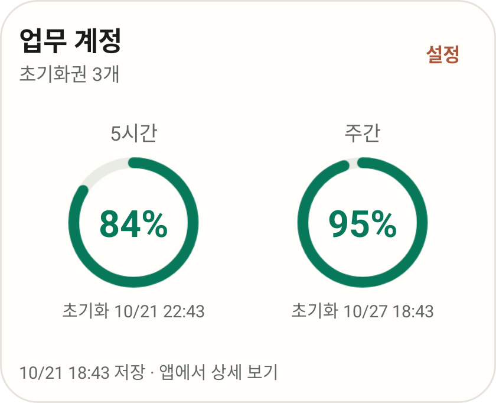

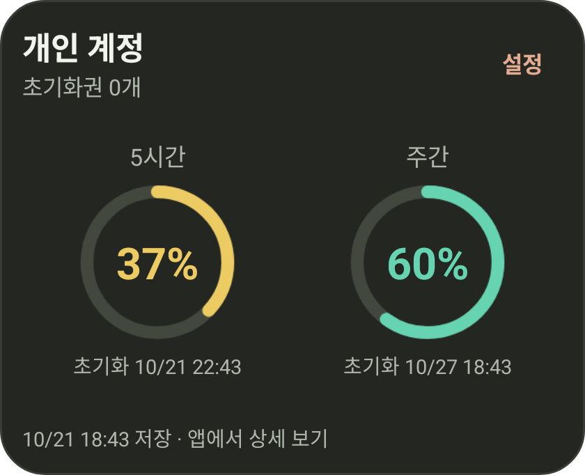

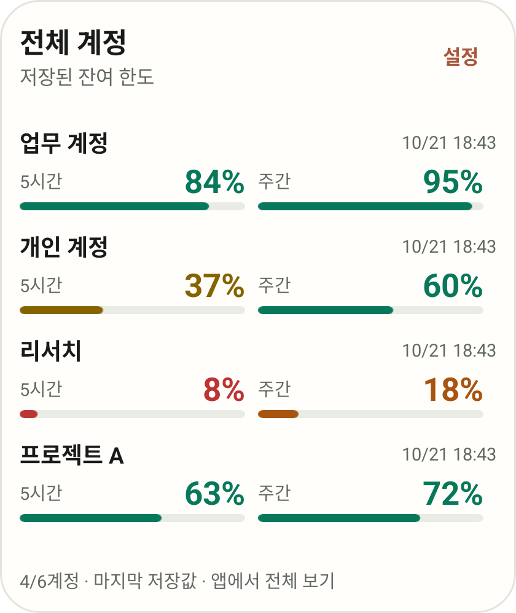

## 다시 빌드

JDK 21, Android SDK Platform/Build Tools 36, NDK 28.2.13676358, Rust 1.96의 aarch64-linux-android 타깃과 프로젝트의 고정된 Node/Bun 도구가 필요합니다. `ANDROID_HOME`, `NDK_HOME`, `JAVA_HOME`을 설치 경로로 설정합니다.

```sh
cd desktop
npm ci
npm run package:android
```

`desktop/src-tauri/gen/android/`의 네이티브 프로젝트에는 위젯 소스가 있으므로 초기화로 덮어쓰지 않습니다. Gradle 9.6.1과 AGP 9.2.0을 사용하며 JNI/Wry glue, 로컬 경로와 빌드 파일은 생성물로 구분합니다. 배포 APK는 서명, 패키지 ID, 버전, ARM64 단일 ABI와 실행 액티비티를 검사한 후 체크섬과 메타데이터를 작성합니다.

백그라운드 브리지는 UniFFI 0.31.2로 생성한 Kotlin 바인딩과 JNA를 사용합니다. 바인딩 원본은 `src/background.rs`이며 변경 시 저장소 루트에서 다음 명령으로 재생성합니다.

```sh
cargo build -p codex-lb-desktop --lib --features android-worker
cargo run -p codex-lb-desktop --bin uniffi-bindgen --features uniffi-cli -- generate --library target/debug/libcodex_lb_desktop_lib.dylib --language kotlin --config desktop/src-tauri/uniffi.toml --out-dir desktop/src-tauri/gen/android/app/src/main/java
```

macOS 호스트 예시이며 다른 호스트는 라이브러리 확장자를 조정합니다. 생성 파일을 직접 수정하지 않습니다. APK 빌드 명령은 `android-worker` 기능을 명시적으로 전달합니다.

에뮬레이터 검증은 실제 휴대폰의 계정 로그인, 제공자 한도 응답, 제조사별 절전 정책 검증을 대신하지 않습니다.

## 화면 예시

개인 계정을 연결하지 않은 Android 16 전용 에뮬레이터에서 확인한 화면입니다.

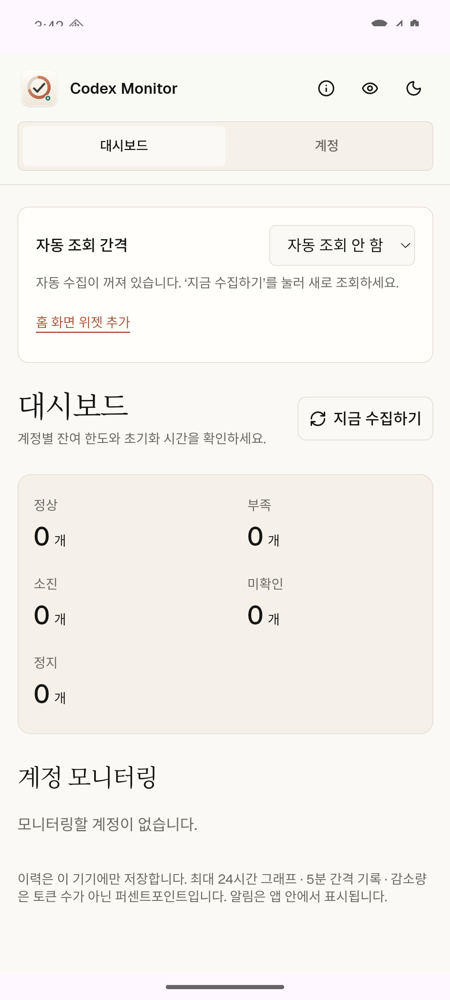

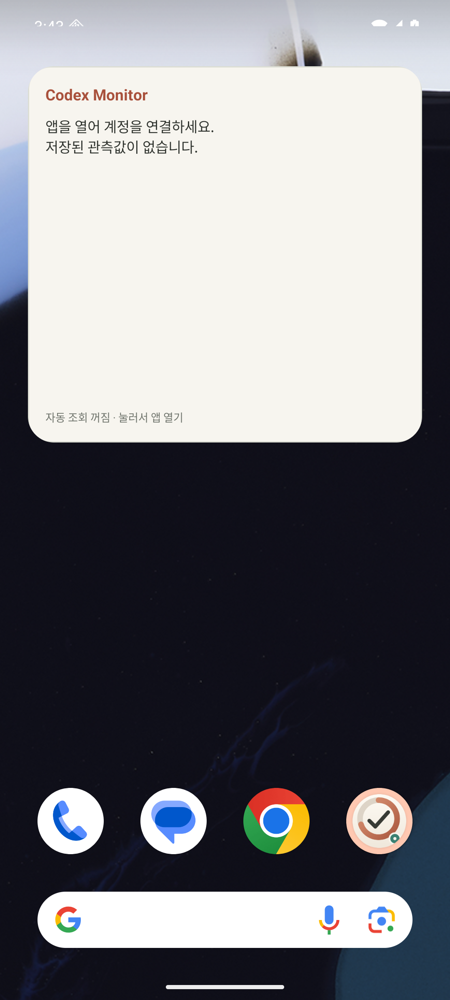

검증한 Android APK는 [GitHub 미리보기 릴리즈](https://github.com/lahuman/Codex_Monitor/releases/tag/android-v0.1.21-preview)에서 제공합니다. 기존 Desktop release 자동화는 Mac·Windows 파일을 게시하며 Android를 자동 첨부하지 않습니다. GitHub에 제공하려면 미리보기 APK를 직접 첨부하고, 메타데이터와 체크섬 파일을 각각 `release-android-arm64.json`, `SHA256SUMS-android-arm64.txt`로 이름을 구분해 함께 올리세요. 계정 로그인 중 인증 상태 확인은 사용량 수집 간격과 별도의 사용자 시작 인증 절차입니다.


## 모바일 카드 대시보드 (0.1.16)

첫 화면은 계정 카드 목록입니다. 상단의 등록·활성·주의 수량 아래에서 계정 별명과 플랜, 5시간·주간 잔여 막대, 초기화까지 남은 시간을 비교합니다. 실제 제공된 기간만 표시하며 미확인 값은 `—`, 오래된 값과 오류는 별도로 표시합니다.

초기화권은 수량과 가장 빠른 만료를 한 줄로 요약합니다. **상세 보기**를 누르면 초기화권 상세, 1·3·6시간 관측 감소량, 최근 24시간 그래프와 알림 설정을 확인합니다. 메뉴의 **메뉴 및 조회 설정**에서 계정 관리, 수집 간격, 홈 위젯과 테마·이메일 가리기를 이용합니다. **지금 수집하기**는 첫 화면에서 바로 사용할 수 있습니다.

아래 화면은 가상 계정으로 검증한 390px 모바일 레이아웃이며 실제 계정 데이터가 아닙니다.

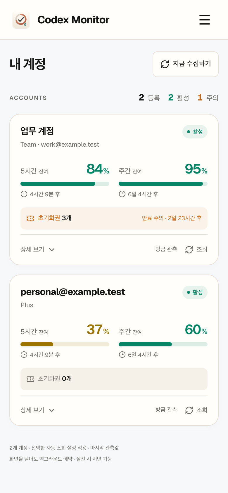

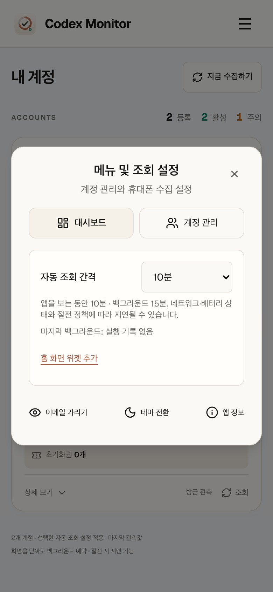
