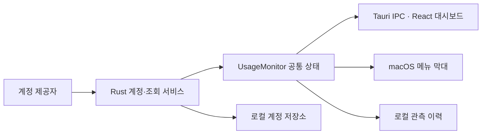

# 개발·구조·검증

> 기준 명세: [desktop-release](https://github.com/lahuman/codex_Monitor/blob/main/openspec/specs/desktop-release/spec.md), [account-monitor](https://github.com/lahuman/codex_Monitor/blob/main/openspec/specs/account-monitor/spec.md), [monitor-documentation](https://github.com/lahuman/codex_Monitor/blob/main/openspec/specs/monitor-documentation/spec.md)

## 준비

| 도구 | 기준 |
| --- | --- |
| Rust | `rust-toolchain.toml`의 1.96.0 |
| Node.js | Vite 엔진 요구사항인 22.12 이상 또는 20.19 이상인 20.x |
| Bun | `frontend/package.json#packageManager`의 1.3.14 |
| macOS 개발 도구 | Xcode Command Line Tools |
| 시스템 | 현재 확인한 빌드는 Apple Silicon, 최소 OS 설정은 macOS 13.3 |

데스크톱 앱의 실행에는 Python 서비스, Docker나 별도 웹 서버가 필요하지 않습니다. 저장소에 남은 Python 프로젝트의 개발 도구는 원본 서비스 작업에 해당합니다.

저장소 루트에서:

```sh
cd frontend
bun install --frozen-lockfile
cd ../desktop
npm ci
npm run dev
```

## 명령어

`desktop/`에서 실행합니다.

| 명령 | 결과 |
| --- | --- |
| `npm run dev` | 개발용 앱 실행 |
| `npm run build:dashboard` | 앱에 포함할 프런트엔드 정적 파일 생성 |
| `npm run build:preview` | 디버그 앱 생성 |
| `npm run build` | 최적화 앱 생성 |
| `npm run icons` | SVG 원본에서 macOS 아이콘 재생성 |
| `npm run package:macos` | 아이콘 재생성, 최적화 앱과 DMG·ZIP·체크섬 생성 |

앱 이름과 버전은 `desktop/src-tauri/tauri.conf.json`, 아이콘 원본은 `desktop/branding/icon.svg`가 기준입니다. 내부 bundle identifier는 기존 데이터 경로를 유지하기 위해 `local.codex-lb.desktop.preview`를 사용합니다.

## 코드 구조

| 경로 | 역할 |
| --- | --- |
| `desktop/src-tauri/src/` | Tauri 명령, 공통 모니터, 로컬 관측 이력, macOS 메뉴 막대 |
| `crates/codex-lb-server/src/business.rs` | 계정·OAuth·인증 갱신·제공자 조회 |
| `crates/codex-lb-server/src/storage.rs` | 데스크톱 전용 암호화 저장소 |
| `frontend/src/desktop/` | 대시보드·계정 UI와 표시 모델 |
| `frontend/src/components/` 등 | 원본에서 이어받은 공통 UI 기반 |
| `desktop/scripts/` | 아이콘 생성과 macOS 패키징 |
| `openspec/specs/` | 기능 계약과 검증 범위 |
| `app/`, 기존 프록시 크레이트·문서 | 함께 보존된 원본 서비스 코드와 자료 |



자동·수동 조회와 오류 상태는 Rust 모니터가 소유합니다. UI와 메뉴 막대는 그 상태를 읽습니다. 기본 데스크톱 빌드는 `legacy-relay`를 활성화하지 않으며 원본의 전체 서버/API 호환을 주장하지 않습니다.

## 로컬 데이터

앱 데이터 위치는 일반적인 macOS 설치에서 `~/Library/Application Support/local.codex-lb.desktop.preview/`입니다. 계정은 암호화 저장소에, 관측 이력과 알림 설정은 별도 로컬 파일에 저장됩니다. 제공자 조회를 위한 인터넷 연결은 필요합니다. 로컬 저장이라는 표현은 네트워크를 전혀 사용하지 않는다는 뜻이 아닙니다.

앱의 계정 파일, 키 파일, 토큰, 실계정이 드러난 캡처는 저장소나 릴리스 첨부물에 포함하지 않습니다. 제공자 응답 형식과 인증 정책 변경에 따라 조회가 영향을 받을 수 있습니다.

## 관련 검증

저장소 루트에서 실행합니다. Rust 앱 테스트 전에는 프런트엔드 산출물을 준비합니다.

```sh
npm --prefix desktop run build:dashboard
bun run --cwd frontend test src/desktop/App.test.tsx src/desktop/insights.test.tsx src/desktop/reset-credits.test.tsx
bun run --cwd frontend lint src/desktop
cargo test -p codex-lb-desktop --bin codex-lb-desktop
cargo clippy -p codex-lb-desktop -p codex-lb-server --all-targets -- -D warnings
```

변경의 행동 계약을 OpenSpec에 먼저 기록하고 구현·문서를 함께 갱신합니다. 실제 제공자 조회, 합성 HTTP 테스트, 미검증 플랫폼을 구분해 기록합니다. 원본 저장소의 전체 CI나 릴리스 워크플로는 데스크톱 앱 전용 검증으로 간주하지 않습니다.

[게시 안내](publishing.md) · [문서 목록](index.md)


## Windows와 프로젝트 웹페이지

Windows x64는 [별도 안내](windows.md)의 C++ Build Tools·WebView2·NASM 전제 조건과 `npm --prefix desktop run package:windows`를 사용합니다. 기본 `npm run build`는 기존 macOS 앱 번들 동작을 유지합니다. Windows 전용 Tauri 설정은 `desktop/src-tauri/tauri.windows.conf.json`에서 자동 병합됩니다.

Windows 계정·이력 저장소는 Tauri의 앱 데이터 디렉터리인 `%APPDATA%\local.codex-lb.desktop.preview\`에 있습니다. Windows에서는 파일 내용을 동기화하고 원자적으로 교체하며, Unix 전용 부모 디렉터리 동기화는 실행하지 않습니다. 같은 식별자를 사용해 같은 플랫폼 내 업데이트에서 저장소를 유지하며, 다른 OS로 계정이 자동 이전되지는 않습니다.

프로젝트 소개 페이지의 소스는 `website/`, 생성 명령은 `node scripts/desktop/build-website.mjs`입니다. [Pages 안내](website.md)를 참고하세요.
