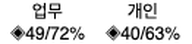
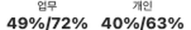
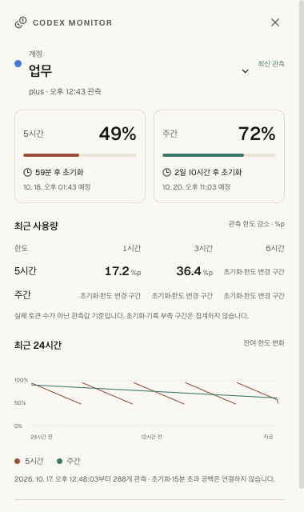

# 기능과 지표

> 기준 명세: [account-monitor](https://github.com/lahuman/Codex_Monitor/blob/main/openspec/specs/account-monitor/spec.md), [monitoring-insights](https://github.com/lahuman/Codex_Monitor/blob/main/openspec/specs/monitoring-insights/spec.md), [reset-credit-monitor](https://github.com/lahuman/Codex_Monitor/blob/main/openspec/specs/reset-credit-monitor/spec.md), [monitoring-design](https://github.com/lahuman/Codex_Monitor/blob/main/openspec/specs/monitoring-design/spec.md)

## 계정별 한도

계정 카드 상단에는 계정 정보, 플랜과 상태가 나옵니다. 아래에는 제공자가 반환한 기간별 한도를 표시합니다. 계정에 따라 5시간·주간·월간 등의 일부 기간만 제공될 수 있습니다.

- **잔여율**: 제공자가 반환한 사용률을 기준으로 계산한 남은 비율입니다.
- **초기화 예정 시각**: 해당 한도 기간이 갱신될 예정인 시각입니다. 시각이 지났다고 임의로 잔여율을 100%로 바꾸지 않고 다음 조회로 확인합니다.
- **범례**: 작은 색상 점과 `잔여 / 사용`을 표시합니다. 계정명은 카드 상단에 모읍니다.
- **미확인**: 제공되지 않은 값이나 오래된 관측을 구분합니다. 알 수 없는 값을 0%로 표시하지 않습니다.

## 자동 조회와 최신성

Rust의 공통 모니터가 계정별 조회를 관리합니다. 데스크톱의 자동 조회 시도는 계정당 최소 60초 간격이며, 수동 새로고침도 같은 경로를 사용합니다. 데스크톱 화면이 보일 때 로컬 상태를 갱신하는 주기는 5초입니다. 화면 갱신마다 제공자에게 새 요청을 보내는 구조는 아닙니다.

최근 조회 시각과 다음 조회 예정 상태를 표시합니다. 2분보다 오래된 관측은 오래된 값으로 취급합니다. 네트워크나 인증 오류가 발생하면 마지막 관측값과 오류 상태를 함께 보여 줍니다. 시스템 절전·네트워크 상황에 따라 실제 조회 시각은 달라질 수 있습니다.

## 초기화권 수량과 만료일

초기화권은 사용 한도를 초기화할 수 있는 이용권입니다. 정해진 한도 초기화 예정 시각이나 유료 추가 사용 크레딧 잔액과 별도입니다.

- 사용 가능한 수량과 각 이용권의 만료일을 표시합니다.
- 만료가 빠른 순서로 정렬하며 날짜가 없는 항목은 뒤에 둡니다.
- 만료일은 기기의 시간대로 표시합니다. 날짜를 받지 못하면 `만료일 미제공`으로 표시합니다.
- 메뉴 막대 빠른 보기는 가장 가까운 미래 만료일 한 개만 먼저 표시합니다. 나머지는 `만료일 전체 보기`를 눌러 확인하며, 전체 수량은 접힌 상태에서도 표시합니다.
- 상세 조회에 실패해도 사용량 응답에서 확인한 수량이 있으면 해당 값과 관측 시각을 남깁니다.
- 수량 0개와 수량 미확인을 구분합니다.

현재 앱은 초기화권을 조회·표시합니다. 이용권 사용이나 자동 소모 기능은 구현 범위에 포함하지 않습니다.

## 상태와 한도 부족 알림

| 상태 | 의미 |
| --- | --- |
| 정상 | 확인된 잔여 한도가 모두 20% 초과 |
| 부족 | 확인된 한도의 최소 잔여율이 0% 초과, 20% 이하 |
| 소진 | 확인된 한도 중 잔여율이 0%인 항목이 있음 |
| 미확인 | 최근 관측이 없거나 오래됐거나 유효한 한도를 확인하지 못함 |
| 정지 | 사용자가 계정의 자동 모니터링을 일시 정지함 |

부족 상태의 20% 기준과 사용자가 설정하는 알림 기준은 서로 다른 항목입니다. 계정별 앱 내 알림은 기본적으로 켜져 있으며 기본 기준은 잔여 10% 이하입니다. 화면에서 5·10·20·30%를 선택할 수 있습니다. 정지·오래된 관측은 새 한도 부족 알림의 대상으로 삼지 않습니다. 알림은 앱 화면에 표시되며 OS 푸시 알림 기능을 의미하지 않습니다.

## 사용 이력과 감소량

최대 최근 24시간의 관측을 그래프로 표시합니다. 로컬 이력은 계정당 5분 간격으로 기록하고, 24시간 그래프와 비교 기준점을 위해 최대 25시간을 보관합니다.

`최근 약 1시간 감소`는 **퍼센트포인트(%p)**입니다. 예를 들어 잔여율이 60%에서 48%가 되면 12%p 감소입니다. 토큰 수, 요청 수나 비용을 뜻하지 않습니다.

초기화 주기가 바뀌거나 관측 사이가 15분을 넘으면 그래프 선을 끊습니다. 충분한 이력이 없거나 비교 조건이 맞지 않으면 감소량은 `—`로 표시합니다. 이 앱이 관측하기 전의 과거 사용량을 소급 생성하지 않습니다.

## 메뉴 막대와 계정 관리

macOS 메뉴 막대는 위쪽에 작은 일반 글씨의 계정 별명, 아래쪽에 더 크고 굵은 잔여율을 두 줄로 표시합니다. 퍼센트 앞에는 장식 기호를 붙이지 않습니다. 계정 설정에서 별명을 저장·변경하거나 비울 수 있습니다. 별명이 없으면 이메일 또는 계정 ID의 앞 3글자를 사용하며, 한글과 결합 이모지를 한 글자로 다룹니다. 긴 별명은 메뉴 막대에서 8글자까지, 최대 4계정과 추가 계정 수를 표시합니다.

변경 전(위)·변경 후(아래)의 가상 계정 네이티브 렌더링 비교입니다. 가독성을 위해 2배로 확대했습니다.

각 계정은 독립적인 메뉴 막대 항목입니다. 해당 계정을 왼쪽 클릭하면 전체 앱 창 대신 그 계정의 작은 빠른 보기 패널을 엽니다. 다른 계정을 누르면 패널이 그 계정으로 전환하고, 같은 계정을 다시 누르면 닫힙니다. 계정 선택, 기간별 잔여 한도, 다음 초기화 날짜·시각과 남은 시간, 최근 1·3·6시간의 관측 한도 감소량(%p), 최근 24시간 잔여 한도 차트를 함께 볼 수 있습니다. 오른쪽 클릭은 기존 전체 계정 메뉴를 엽니다. 패널 바깥 클릭·Escape로 닫고, 명시적인 대시보드 열기로 전체 창을 엽니다.

최근 사용량은 실제 토큰 수가 아니라 관측된 잔여 한도 감소량입니다. 약 5분 간격의 관측을 사용하고 구간 시작 기준 최대 10분 차이를 허용하므로 근사치입니다. 기록 부족·15분 초과 공백·한도 초기화·설정 변경·중간 잔여율 증가가 있으면 이유와 함께 집계 불가로 표시합니다. 정지·조회 실패·오래된 관측은 현재 사용량 합계로 표시하지 않습니다. 한도가 초기화될 시각이 지나도 새 잔여량을 추정하지 않습니다. 창의 닫기 버튼은 앱을 숨기며 자동 조회는 계속됩니다. 메뉴의 앱 종료 또는 종료 명령은 모니터링을 종료합니다.

계정 화면은 기기 코드 로그인, 주소·코드 복사, 원하는 브라우저에서의 인증, 사용자가 선택한 `auth.json` 가져오기, 일시 정지/재개와 연결 해제를 제공합니다. 원본 Codex의 설정 파일을 자동 수정하지 않습니다. 밝은/어두운 테마와 화면의 이메일 흐림 표시를 지원합니다. 흐림 표시는 모든 표시 경로를 포함하는 완전한 익명화 기능으로 설명하지 않습니다.

[문서 목록](index.md) · [개발 안내](development.md)

위 화면은 실제 계정 정보가 없는 검증용 예시입니다.

## Windows 알림 영역

Windows에서는 macOS처럼 트레이 아이콘 옆에 텍스트를 상시 표시할 수 없습니다. 앱 아이콘을 알림 영역에 표시하고, 마우스를 올리면 계정별 잔여율 요약을 툴팁으로 제공합니다. 메뉴에는 모든 계정의 기간별 잔여율·최근 조회 상태와 대시보드 열기·앱 종료가 있습니다. 창을 닫으면 숨겨지며 모니터링을 유지합니다. Windows 설정에 따라 아이콘은 숨겨진 아이콘 영역에 위치할 수 있습니다.

Windows 설치 파일 생성과 실제 PC 검증 상태는 [Windows 안내](windows.md)에 구분합니다.

## 초기화권 만료 경고 (0.1.2)

대시보드 상단에 계정별 만료 경고를 표시하고, 각 초기화권에는 만료 날짜와 남은 기간을 함께 표시합니다.

| 남은 유효 기간 | 표시 |
| --- | --- |
| 7일 이상 | 남은 기간과 만료 날짜 |
| 24시간 초과·7일 미만 | **만료 주의** 배지와 경고 |
| 0초 초과·24시간 이하 | **만료 임박** 배지와 더 강한 경고 |
| 만료 시각 도달·경과 | **만료 시각 경과 · 갱신 필요**; 미래 만료 경고에서는 제외 |

경고에는 확인된 해당 초기화권의 수량과 가장 빠른 만료까지 남은 시간을 표시합니다. 색상만으로 구분하지 않고 문구와 아이콘도 제공합니다. 날짜는 기기의 시간대를 사용합니다.

현재 경고는 계정이 활성 상태이고, 수량이 알려진 양수이며, 상세 조회 오류가 없고 관측값이 2분 이내일 때만 표시합니다. 조회 시각이 없거나 미래인 경우도 현재 경고에서 제외합니다. 정지·오래된 관측·상세 조회 실패에서는 마지막 날짜와 상태를 유지하되 현재 유효한 경고로 강조하지 않습니다. 수량 0은 남아 있는 상세 목록보다 우선하며, 사용됨·알 수 없는 상태·만료일 미제공 항목은 임박 수량에 포함하지 않습니다. 관측 수량보다 상세 내역이 많으면 불일치로 표시하고 갱신을 기다립니다.

화면은 기존 5초 간격과 포커스 복귀 시 남은 기간을 갱신합니다. 앱 내부 조회가 실패해도 시계는 진행하므로 과거 경고가 최신인 것처럼 남지 않습니다. 제공자 조회 주기는 추가하지 않습니다. 경고는 앱 안에서 표시하며 OS 푸시 알림은 보내지 않습니다. 기존 잔여 한도 부족 알림 설정과 별개입니다.

만료 시각이 지나도 제공자가 관측한 초기화권 수량을 임의로 차감하지 않습니다. 원본에는 수동 사용과 선택적 만료 5분 전 자동 사용도 있지만, 이 앱에서는 초기화권 사용·자동 사용 요청을 실행하지 않습니다.

원본 비교 기준은 아래 [출처 문서](provenance.md)의 고정 커밋을 참고하세요.

메뉴 막대에서 계정을 클릭하면 초기화권 수량과 만료일·남은 시간을 함께 확인합니다. 유효한 초기화권이 24시간 이하로 남으면 해당 계정의 별명이 빨간색으로 표시됩니다. 만료된 이용권, 중지된 계정, 조회 실패 또는 120초를 넘긴 관측 정보에는 현재 경고를 표시하지 않습니다.

메뉴 막대는 별명 7pt 보통 굵기, 퍼센트 12pt 중간 굵기로 표시합니다. 최종 22pt 높이에서 macOS가 화면 배율에 맞춰 직접 그려 축소 이미지의 흐릿함을 줄였습니다.

[메뉴 막대 글꼴 수정 전후 비교](assets/menubar-sharp-type.png) — 가상 계정으로 밝은/어두운 배경과 Retina 렌더링을 확인한 확대 이미지입니다.

메뉴 막대의 각 잔여 퍼센트는 50% 이상 녹색, 25% 이상 노랑, 10% 이상 주황, 10% 미만 빨강으로 구분합니다. 경계는 반올림 전 실제 값이며, 미확인 값과 상태 표시는 기본 색을 유지합니다. 밝은 배경에서는 노랑·주황을 더 짙게 표시해 가독성을 확보합니다. 초기화권은 전체 수량과 가장 가까운 미래 만료일 한 개를 먼저 보여주며, ‘만료일 전체 보기’로 나머지를 펼치거나 접을 수 있습니다.

[잔여 한도 색상 미리보기](assets/menubar-quota-colors.png) — 가상 계정을 사용한 밝은/어두운 메뉴 막대 렌더링입니다.

메뉴 막대 팝업의 초기화권은 수량·경고 배지·전체 보기와 가장 가까운 만료일 한 줄로 간소화했습니다. 나머지 만료일은 전체 보기를 눌러야 표시됩니다. 기본 창에서 최근 사용량과 24시간 차트를 함께 볼 수 있도록 간격을 줄였으며, 내역을 펼치거나 긴 오류가 있는 경우에는 스크롤로 모두 확인할 수 있습니다.

[초기화권을 간소화한 팝업 미리보기](assets/menubar-vouchers-compact.png) — 가상 계정으로 두 종류의 한도와 차트를 함께 표시한 화면입니다.

## Android 대시보드와 홈 위젯

휴대폰은 별도 PC 없이 기기 코드로 계정을 연결합니다. 계정 카드에서 기간별 잔여율·초기화 예정 시각을 한눈에 비교하고, 상세 화면에서 초기화권과 관측 이력을 확인합니다. 자동 조회는 끄기 또는 1·5·10·30·60·100분을 선택하고 **지금 수집하기**로 직접 조회합니다. 백그라운드는 Android WorkManager의 최소 15분·네트워크·배터리 조건을 따르며 정확한 시각이나 강제 종료 중 동작을 보장하지 않습니다.

홈 위젯은 저장된 관측만 읽으며 자체 API 호출이나 주기 타이머를 추가하지 않습니다. 위젯별로 전체/특정 계정, 원형/막대, 테마와 이름 숨김을 설정합니다. 상단 오른쪽에는 갱신 시각 하나, 기간별 그래프 아래에는 각각의 초기화 날짜·시간을 표시합니다. 큰 글씨·좁은 위젯에서는 줄바꿈과 표시 계정 수를 조정하고 공간이 부족하면 크기 조정 안내를 표시합니다. [Android 설치·운영 상세](android.md) · [Android 기능 계약](https://github.com/lahuman/Codex_Monitor/blob/main/openspec/specs/android-monitor/spec.md)
